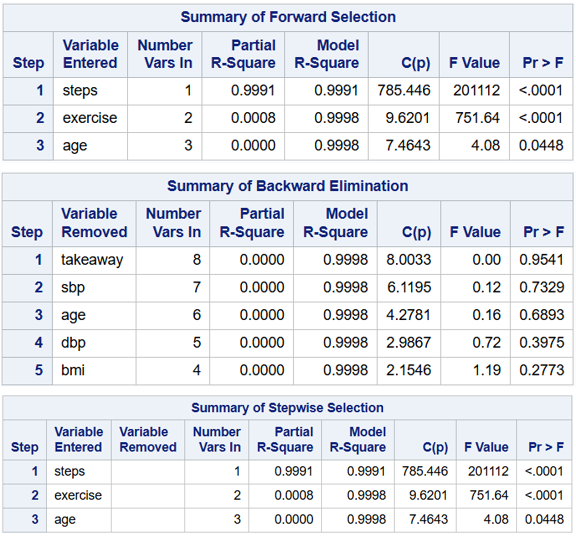
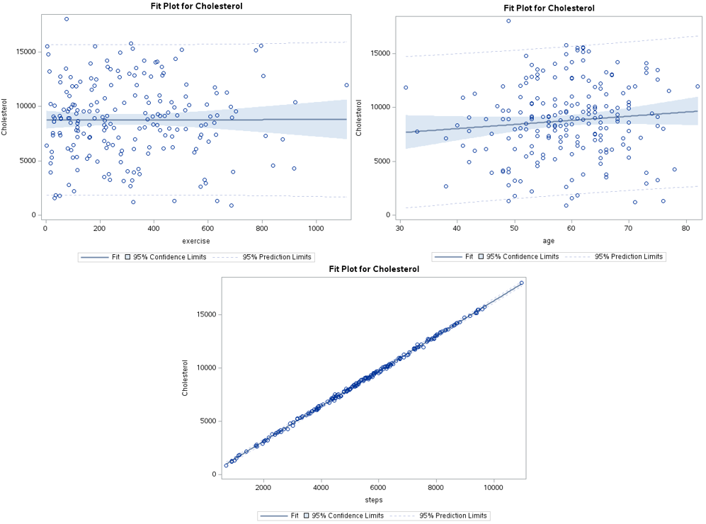

# Statistical modeling of cholesterol

A multiple linear regression on a simulated dataset of 200 people, to find which of steps, age, BMI, blood pressure, gender, weekly exercise and weekly takeaways are linked to cholesterol. It is written as advice to a public health body. Written with Ruairi McCann as a university report.

The data is simulated, not real patient data. That is why the fit is almost perfect, and it also means none of the findings should be read as health advice. In this data cholesterol goes up with steps, which is the opposite of what you would expect in real people.

## What it found

- Steps explains almost everything. On its own it gives an R-squared of 0.9991.
- Age and exercise explain almost nothing on their own (R-squared of 0.01 and 0.000004). Once steps is in the model, both become significant with negative coefficients, so steps was hiding their effect.
- Forward and stepwise selection both picked steps, exercise and age. Adding the other four variables (gender, blood pressure, BMI, takeaways) did not improve the fit, which stays at R-squared 0.9998.
- Final model: cholesterol = 12.878 + 1.650 (steps) - 0.773 (age) - 0.412 (exercise).

## Checks

- Multicollinearity is not a problem. The variance inflation factors are all about 1, and the Type I and Type III sums of squares agree.
- 13 influential observations were identified using Cook's distance, DFFITS and DFBETAS. Removing them did not change the fit.
- The Box-Cox procedure gave lambda = 1, so no transformation was needed. Square root, log and Box-Tidwell transformations all fit worse (R-squared of 0.97, 0.88 and 0.95, against 0.9998).
- A gender and age interaction was significant when added to the full model (p = 0.027): age was linked to higher cholesterol in women and lower cholesterol in men. It was not part of the three-variable model that selection settled on.

## Methods

Exploratory analysis and plots, assumption checks, multiple linear regression, forward, backward and stepwise selection, ANOVA (Type I and III sums of squares), leverage and influence diagnostics, Box-Cox and Box-Tidwell transformations, variance inflation factors, interaction effects.

## Files

| File | What it is |
|---|---|
| `Cholesterol_report.pdf` | The report (12 pages) |
| `Cholesterol_code.sas` | SAS code |

## Running it

You need SAS. The data file (`newCAD_2.csv`) is not included here, and the code reads it from a path in the university SAS environment, so change that first.
